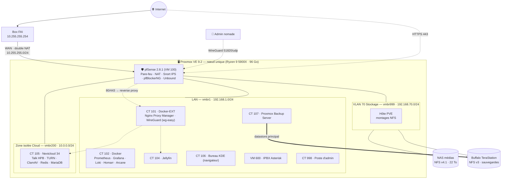
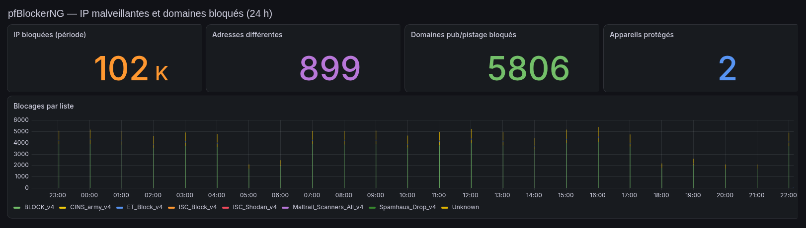
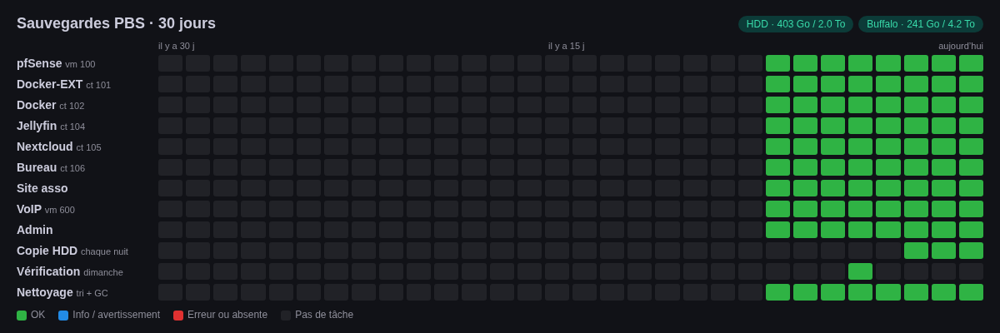
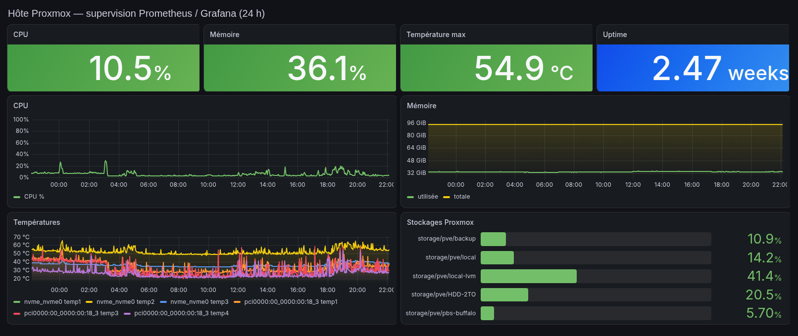

# 🏠 HomeLab — Infrastructure virtualisée et sécurisée sous Proxmox VE


> **Hugo Loureiro** — ingénieur cybersécurité & réseaux (Bac+5).
> Portfolio : **[hloureiro.fr](https://hloureiro.fr)**

Un serveur unique (Ryzen 9 · 96 Go RAM) qui fait tourner **une infrastructure complète de type PME** :
pare-feu/IPS virtualisé, zones réseau séparées, VPN, reverse proxy TLS, services collaboratifs,
téléphonie IP, supervision centralisée avec alerting, et sauvegardes dédupliquées et vérifiées.
Le lab est **en production** : il héberge des services utilisés au quotidien (une cinquantaine de comptes utilisateurs sur le serveur multimédia).

---

## Sommaire

- [Architecture](#-architecture)
- [Machines virtuelles et conteneurs](#-machines-virtuelles-et-conteneurs)
- [Plan d'adressage](#-plan-dadressage)
- [Matrice des flux](#-matrice-des-flux)
- [Sécurité](#-sécurité--défense-en-profondeur)
- [Sauvegardes](#-sauvegardes)
- [Supervision](#-supervision)
- [Chiffres clés](#-chiffres-clés)
- [Compétences démontrées](#-compétences-démontrées)
- [Limites et prochaines étapes](#-limites-et-prochaines-étapes)
- [Documentation détaillée](#-documentation-détaillée)

---

## 🗺️ Architecture



> Le diagramme est simplifié : la liste complète des flux autorisés est dans la [matrice des flux](#-matrice-des-flux) et dans [docs/03-reseau.md](docs/03-reseau.md).

---

## 📦 Machines virtuelles et conteneurs

| ID | Nom | Type | Rôle | OS | vCPU / RAM / disque | Zone | Exposition Internet |
|---|---|---|---|---|---|---|---|
| 100 | PF | VM | Routeur, pare-feu, IPS, DNS | pfSense 2.8.1 (FreeBSD 15) | partagé / 2 Go / 32 Go | WAN · LAN · OPT1 · VLAN70 | ✅ périmètre |
| 600 | VOIP | VM | Téléphonie IP (Asterisk, configuré à la main) | Linux | partagé / 2 Go / 32 Go | LAN | ✅ SIP/RTP |
| 101 | Docker-EXT | LXC | Reverse proxy TLS, VPN WireGuard, applications web perso | Debian | 4 Go / 20 Go | LAN | ✅ 80/443, 51820/udp |
| 102 | Docker | LXC | Supervision, tableau de bord, gestion Docker | Debian | 6 Go / 130 Go | LAN | ❌ (LAN/VPN via NPM) |
| 104 | JELLYFIN | LXC | Serveur multimédia | Debian | 8 Go / 50 Go | LAN | ✅ via NPM |
| 105 | NEXTCLOUD | LXC | Cloud privé, visio (Talk), tableau blanc | Debian | 4 Go / 32 Go + NFS | **OPT1 isolée** | ✅ via NPM + TURN |
| 106 | BUREAU | LXC | Bureau KDE Plasma accessible par navigateur | Debian | 8 vCPU / 8 Go / 40 Go | LAN | ❌ (LAN/VPN) |
| 107 | PBS | LXC | Proxmox Backup Server 4.2 | Debian | 8 vCPU / 4 Go / 16 Go | LAN + VLAN70 | ❌ (LAN/VPN) |
| 202 | Chronique-ASSO | LXC | Site web associatif *(arrêté)* | Debian | 1 Go / 16 Go | LAN | — |
| 998 | Claude-code | LXC | Poste d'administration / automatisation | Debian | 4 Go / 32 Go | LAN | ❌ |

> Tous les conteneurs LXC sont **non privilégiés**. Quelques machines personnelles ou hébergées pour des tiers ne sont volontairement pas documentées ici.

---

## 🌐 Plan d'adressage

| Zone | Bridge Proxmox | Réseau | Passerelle | Usage |
|---|---|---|---|---|
| WAN (transit) | `vmbr0` (nic0) | 10.255.255.0/24 | 10.255.255.254 (box) | pfSense `.253`, hôte Proxmox `.252` |
| LAN | `vmbr1` (virtuel) | 192.168.1.0/24 | 192.168.1.254 (pfSense) | Services et administration |
| OPT1 — Cloud | `vmbr200` (virtuel) | 10.0.0.0/24 | 10.0.0.254 (pfSense) | Nextcloud seul, isolé |
| VLAN70 — Stockage | `vmbr999` (nic1) | 192.168.70.0/24 | — | NFS vers les NAS, interface dédiée |
| VPN | wg-easy (CT 101) | 10.8.0.0/24 | — | Clients WireGuard nomades |

Détails : [docs/03-reseau.md](docs/03-reseau.md).

## 🔀 Matrice des flux

| Source ↓ / Destination → | LAN | OPT1 Cloud | VLAN70 Stockage | Internet |
|---|---|---|---|---|
| **Internet** | 80/443 → reverse proxy uniquement · 51820/udp → VPN · SIP/RTP → IPBX | via reverse proxy · TURN/STUN (3478, UDP Talk) | ❌ | — |
| **VPN (10.8.0.0/24)** | ✅ (admin) | via reverse proxy | ❌ | ✅ |
| **LAN** | ✅ | via reverse proxy | hôte PVE et PBS seulement | ✅ (filtré DNSBL) |
| **OPT1 Cloud** | ❌ | — | ❌ (stockage monté par l'hôte, pas par le CT) | ✅ |
| **VLAN70** | ❌ | ❌ | — | ❌ |

Les interfaces d'administration (Proxmox, PBS, Grafana, Arcane, VPN, bureau…) passent par le reverse proxy
avec une **liste d'accès** `LAN + VPN` puis `deny all` : elles ont un nom DNS mais ne répondent pas depuis Internet.

---

## 🛡️ Sécurité — défense en profondeur

| Couche | Mesure |
|---|---|
| Périmètre | pfSense virtualisé, politique de refus par défaut, **seuls 443/80, le VPN, la VoIP et le TURN** sont publiés |
| Détection / prévention | **Snort** sur le WAN en mode blocage (règles Community + ET Open, politique IPS « security »), blocage de la source pendant 1 h, liste de suppression pour les faux positifs |
| Réputation / DNS | **pfBlockerNG** : listes IP mises à jour quotidiennement + **DNSBL ~352 000 domaines** (publicité, malware, phishing : HaGeZi TIF, Phishing Army, URLhaus) en mode Python |
| Segmentation | Cloud exposé (Nextcloud) **isolé dans sa propre zone**, stockage sur une **interface physique dédiée** non routée |
| Accès distant | **WireGuard** (5 pairs) ; aucune interface d'admin exposée en direct |
| Publication | Reverse proxy **TLS Let's Encrypt** ; listes d'accès LAN/VPN sur toutes les consoles d'admin |
| Isolation | **LXC non privilégiés** partout ; montages NAS en **lecture seule** pour les services qui n'ont besoin que de lire |
| Applicatif | Nextcloud : antivirus **ClamAV**, Redis pour le verrouillage, base MariaDB non exposée (réseau Docker interne) |
| Journalisation | Logs pfSense / Snort / pfBlockerNG → **Loki**, tableaux de bord et alertes Grafana |
| Réaction | Gestion d'une faille PHP critique (oct. 2026) : correctifs appliqués après **répétition sur un clone** de la production |



Détails, modèle de menace et durcissement : [docs/04-securite.md](docs/04-securite.md).

---

## 💾 Sauvegardes

Stratégie **3-2-1 en cours** (la copie hors site est la prochaine étape) :

```
Chaque nuit 01:00   vzdump → Proxmox Backup Server  (toutes les machines)
                     └─ datastore « buffalo »  (NAS Buffalo, NFS)    ← copie 1
04:00               sync PBS → datastore « hdd » (disque local 2 To)  ← copie 2
Dimanche            vérification d'intégrité des deux datastores
Rétention           7 quotidiennes · 4 hebdomadaires · 6 mensuelles
Échec / alerte      notification ntfy immédiate
```

- **Déduplication** PBS : environ 2 To de données sauvegardées n'occupent que ~216 Go sur le datastore.
- **Test de restauration réalisé** : restauration complète d'un conteneur sous un nouvel ID, vérification, puis suppression.
- Le serveur PBS est lui-même sauvegardé à part, chaque semaine, sur le disque local.



Détails : [docs/06-sauvegardes.md](docs/06-sauvegardes.md).

---

## 📊 Supervision

**Prometheus + Grafana + Loki + Alloy**, avec les exporters node, PVE, SNMP (NAS) et blackbox (ping de toutes les machines).
- Tableaux de bord : vue globale du lab, Proxmox, hôte, pfSense, pfBlockerNG, sécurité.
- **Alertes rédigées en français**, avec résumé, cause probable et action à mener, envoyées sur téléphone via **ntfy**.
- Canal séparé pour les **mises à jour** Proxmox et Docker.
- Tableau de bord Homarr avec une **grille des sauvegardes sur 30 jours**, « façon GitHub ».



Projet associé : **[baszel-snmp-bridge](https://github.com/Lightshadow02/baszel-snmp-bridge)**, un pont SNMP que j'ai développé pour remonter les équipements réseau dans Beszel, l'outil de supervision utilisé avant la pile Prometheus/Grafana.

Détails : [docs/07-supervision.md](docs/07-supervision.md).

---

## 🔢 Chiffres clés

*Relevés le 5 novembre 2026.*

| | |
|---|---|
| Hôte | 1 nœud Proxmox · 24 threads · 96 Go RAM · NVMe 2 To + HDD 2 To |
| Invités documentés | 2 VM et 7 LXC en service, 1 LXC arrêté |
| Conteneurs Docker | plus de 35 (hors machines non documentées) |
| Services publiés | ~21 hôtes virtuels derrière le reverse proxy, dont 14 réservés au LAN/VPN |
| Règles pare-feu | 121 règles pfSense |
| DNSBL | ~352 000 domaines bloqués |
| Stockage réseau | 22 To (médias) + 11,6 To (sauvegardes) |
| Disponibilité | 17 jours depuis le dernier redémarrage planifié de l'hôte |

---

## 🎯 Compétences démontrées

| Domaine | Mise en pratique dans ce lab | Lien avec un poste |
|---|---|---|
| Sécurité réseau | pfSense, segmentation en zones, politique de refus par défaut, NAT, double NAT | Admin sécurité réseau |
| Détection d'intrusion | Snort IPS, gestion des faux positifs, pfBlockerNG / DNSBL | Analyste SOC |
| Journalisation / SIEM | Centralisation syslog → Loki, tableaux de bord et alertes de sécurité | Analyste SOC |
| Virtualisation | Proxmox VE, VM vs LXC, stockage LVM-thin, bridges, montages NFS | Admin systèmes |
| Conteneurisation | Docker / Compose, réseaux internes, conteneurs non privilégiés | DevOps / Admin |
| Sauvegarde / PRA | PBS, rétention, vérification, tests de restauration | Admin systèmes |
| Supervision | Prometheus, exporters, SNMP, alerting | Admin / NOC |
| Accès distant | WireGuard, reverse proxy, listes d'accès | Admin réseau |
| Gestion de vulnérabilités | Veille CVE, correctifs priorisés, répétition sur clone avant production | SOC / Admin |
| Automatisation | Scripts Python et Bash (rapports, maintenance, intégrations API) | Admin / DevOps |
| Téléphonie | IPBX Asterisk (SIP/RTP) | Admin réseau / télécom |

---

## 🚧 Limites et prochaines étapes

Ce lab tourne sur **un seul serveur**, dans un **contexte domestique**. C'est une force pour apprendre, mais cela impose des limites :

- **Point unique de défaillance** : pas de cluster ni de haute disponibilité. Un redémarrage de l'hôte coupe aussi Internet, puisque le routeur est virtualisé.
- **Double NAT** imposé par la box du FAI.
- **Pas encore de copie de sauvegarde hors site** : le 3-2-1 est incomplet.
- Pas de SIEM au sens strict : Loki et Grafana centralisent et alertent, mais sans moteur de corrélation.
- Durcissement en cours, suivi en interne (accès d'administration, segmentation plus fine).

Prochaines étapes : **SIEM**, **SSO**, **accélération GPU (NVENC)**, copie hors site. Voir [docs/09-roadmap.md](docs/09-roadmap.md).

---

## 📚 Documentation détaillée

| Document | Contenu |
|---|---|
| [01 — Matériel](docs/01-materiel.md) | Serveur, disques, réseau, NAS |
| [02 — Proxmox](docs/02-proxmox.md) | Version, stockage, bridges, conventions d'ID |
| [03 — Réseau](docs/03-reseau.md) | Zones, adressage, flux, NAT, DNS |
| [04 — Sécurité](docs/04-securite.md) | pfSense, Snort, pfBlockerNG, VPN, modèle de menace |
| [05 — Services](docs/05-services.md) | Une fiche par service |
| [06 — Sauvegardes](docs/06-sauvegardes.md) | PBS, rétention, restauration |
| [07 — Supervision](docs/07-supervision.md) | Prometheus, Grafana, Loki, alertes |
| [08 — Historique](docs/08-historique.md) | Évolution du lab et leçons apprises |
| [09 — Roadmap](docs/09-roadmap.md) | Ce qui est prévu |
| [configs/](configs/) | Extraits de configuration **nettoyés** |
| [scripts/](scripts/) | Scripts d'exploitation commentés |
| [portfolio/](portfolio/) | Textes, données JSON et page HTML pour le portfolio |

---

<sub>Toutes les informations proviennent d'un inventaire en lecture seule de l'infrastructure. Les secrets, l'adresse IP publique et les noms de domaine ont été retirés.</sub>
