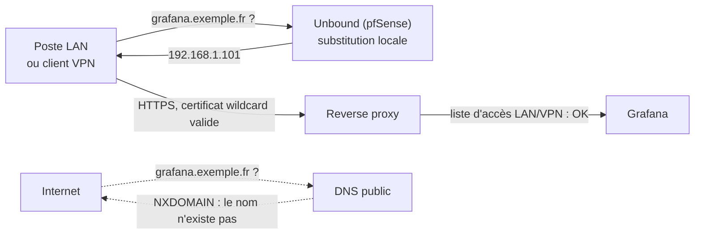

# 03 — Réseau

[← Retour au README](../README.md)

## Contexte

Le lab est sur un **réseau domestique**. L’accès Internet passe par une box du FAI que je ne contrôle pas complètement.
pfSense est donc placé **derrière** la box, ce qui crée un **double NAT** :

```text
Internet ──▶ Box FAI (IP publique, NAT n°1) ──▶ 10.255.255.0/24 ──▶ pfSense (NAT n°2) ──▶ zones internes
```

Conséquence : chaque port publié doit être redirigé **deux fois**, sur la box vers pfSense, puis sur pfSense vers le service.
C'est une contrainte, mais elle offre un **contrôle fin** : rien n'entre sans être explicitement autorisé à deux endroits.

## Zones

| Zone | Réseau | Bridge | Passerelle | Contenu | Philosophie |
|---|---|---|---|---|---|
| **WAN (transit)** | 10.255.255.0/24 | `vmbr0` | box `.254` | pfSense `.253`, hôte `.252` | Transit vers la box uniquement |
| **LAN** | 192.168.1.0/24 | `vmbr1` | pfSense `.254` | Services, administration, supervision | Zone de confiance, accès admin |
| **OPT1 — Cloud** | 10.0.0.0/24 | `vmbr200` | pfSense `.254` | Nextcloud (seul) | Hébergement exposé, **isolé** |
| **VLAN70 — Stockage** | 192.168.70.0/24 | `vmbr999` | aucune (non routé vers Internet) | NAS médias, Buffalo, hôte `.10`, PBS `.11` | Stockage uniquement |
| **VPN** | 10.8.0.0/24 | wg-easy | CT 101 | Clients WireGuard | Accès admin à distance |

### Pourquoi isoler Nextcloud ?

Nextcloud est un service d'**hébergement de fichiers exposé sur Internet**, donc une surface d'attaque importante.
En cas de compromission, la zone OPT1 empêche l'attaquant d'atteindre directement le LAN d'administration.
Les données sont montées **par l'hôte** et transmises au conteneur : le conteneur n'a **aucun accès réseau** au NAS.

### Pourquoi un réseau de stockage dédié ?

- Le trafic NFS, volumineux, ne passe pas par le pare-feu virtuel et ne le charge pas.
- Les NAS ne sont **pas joignables** depuis le LAN des services, et encore moins depuis Internet.
- Seuls l'hôte Proxmox et le serveur de sauvegarde (2e interface) ont une patte sur ce réseau.

## Plan d'adressage (machines documentées)

| Adresse | Machine |
|---|---|
| 192.168.1.254 | pfSense (LAN) |
| 192.168.1.1 | CT 102 — Supervision / Docker |
| 192.168.1.50 | VM 600 — IPBX Asterisk |
| 192.168.1.101 | CT 101 — Reverse proxy + VPN |
| 192.168.1.102 | CT 104 — Jellyfin |
| 192.168.1.106 | CT 106 — Bureau KDE |
| 192.168.1.107 | CT 107 — PBS |
| 10.0.0.254 | pfSense (OPT1) |
| 10.0.0.100 | CT 105 — Nextcloud |
| 192.168.70.10 | Hôte Proxmox (stockage) |
| 192.168.70.11 | CT 107 — PBS (2e interface stockage) |
| 192.168.70.192 | pfSense (VLAN70) |

## Flux publiés depuis Internet

| Service | Port(s) externe(s) | Destination | Justification |
|---|---|---|---|
| Reverse proxy | 80, 443 (TCP) | CT 101 | Point d'entrée **unique** de tous les sites web (TLS) |
| VPN WireGuard | 51820 (UDP) | CT 101 | Accès d'administration à distance |
| Nextcloud Talk (TURN/STUN) | 3478 TCP/UDP + plages UDP | CT 105 | Visio : relais média nécessaire derrière NAT |
| Téléphonie IP | SIP + plage RTP (UDP) | VM 600 | Trunk et postes distants |

Tout le reste est **refusé par défaut**. Le détail des règles est volontairement résumé, sans être copié tel quel.

## Reverse proxy : deux niveaux d'exposition

**Nginx Proxy Manager** publie environ 21 hôtes virtuels, avec certificats **Let's Encrypt**.

| Type | Exemples | Contrôle d'accès |
|---|---|---|
| **Public** | Jellyfin, Nextcloud, Talk, applications web perso | Authentification applicative, HTTPS |
| **Interne** (×14) | Proxmox, PBS, Grafana, Arcane, VPN, bureau, tableau de bord… | **Liste d'accès** : LAN, VPN, réseau Docker interne, puis `deny all` |

Les consoles d'administration ont donc un nom DNS et un certificat valide, mais **ne répondent pas depuis Internet**.
En interne, des **substitutions DNS** dans Unbound (pfSense) font pointer ces noms directement vers le reverse proxy.

## DNS local (split-horizon)

Tous les services du lab ont un **nom de domaine**, mais il existe **deux vues du DNS** :

| Nom | Vu depuis Internet (DNS public) | Vu depuis le LAN ou le VPN (DNS local) |
|---|---|---|
| Services publics (`cloud`, `jelly`, …) | Adresse publique → box → pfSense → reverse proxy | Résolu localement |
| **Consoles internes** (`proxmox`, `pbs`, `grafana`, `wg`, `bureau`, …) | **N'existe pas** : aucun enregistrement public | Adresse **privée du reverse proxy** |



Comment c'est fait :
- **Unbound** (pfSense) est le résolveur unique de toutes les zones, et du VPN. Il fonctionne en **résolution récursive complète** (sans redirection vers un DNS tiers), avec **validation DNSSEC**.
  Vérification : les réponses signées portent le drapeau `ad`, et un domaine volontairement mal signé est refusé (`SERVFAIL`).
- **15 substitutions d'hôtes** (*host overrides*) font pointer chaque console interne vers l'adresse privée du reverse proxy.
- **pfBlockerNG DNSBL**, en mode Python, filtre environ 352 000 domaines (publicité, malware, phishing) **pour tous les clients**, y compris le bureau à distance et les clients VPN.

Pourquoi c'est intéressant pour la sécurité :
- **Pas de fuite d'information** : un attaquant qui énumère les sous-domaines publics (DNS, journaux de transparence des certificats) ne voit **pas** les consoles d'administration, puisqu'elles sont couvertes par un certificat wildcard et absentes du DNS public.
- **Double barrière** : même si quelqu'un devinait un nom interne et forçait la résolution, la **liste d'accès** du reverse proxy refuse toute adresse hors LAN et VPN.
- **Confort** : des URL lisibles et des certificats valides partout, sans avertissement du navigateur ni adresse IP à retenir.

## Interfaces réservées

Trois bridges supplémentaires (`vmbr20`, `vmbr40`, `vmbr41`) sont créés mais **non utilisés** à ce jour. Ils sont prévus pour une segmentation plus fine. Voir [09 — Roadmap](09-roadmap.md).
