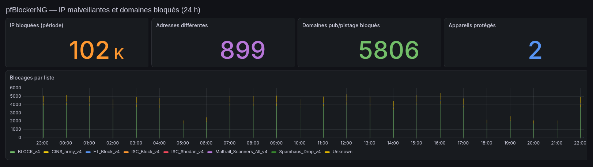

# 04 — Sécurité

[← Retour au README](../README.md)

## Modèle de menace

| Menace | Probabilité | Ce qui est en place |
|---|---|---|
| Scans et attaques automatisées sur les ports publiés | **Très élevée** (permanente) | Peu de ports publiés, Snort en blocage, listes de réputation IP |
| Exploitation d'une faille d'application web exposée | Élevée | Reverse proxy unique, mises à jour suivies, zone isolée pour le cloud, veille CVE |
| Vol d'identifiants / force brute sur les consoles d'admin | Moyenne | Consoles **non joignables** depuis Internet (liste d'accès LAN/VPN) |
| Navigation vers un domaine malveillant depuis le lab | Moyenne | DNSBL pfBlockerNG (malware, phishing) |
| Mouvement latéral après compromission d'un service | Moyenne | Zones séparées, LXC non privilégiés, montages en lecture seule |
| Perte de données (erreur, panne, rançongiciel) | Moyenne | PBS : 2 copies, vérifications, rétention 6 mois |
| Fraude téléphonique (toll fraud) sur l'IPBX | Moyenne | Exposition SIP limitée ; filtrage GeoIP prévu |

## pfSense : le périmètre

- **pfSense 2.8.1**, en VM, avec 4 cartes virtuelles : WAN, LAN, OPT1 et stockage.
- Politique de **refus par défaut** sur le WAN ; 121 règles au total, organisées par zone.
- Le NAT publie uniquement les services listés dans [03 — Réseau](03-reseau.md#flux-publiés-depuis-internet).
- Les logs sont envoyés en **syslog** vers Loki (voir [07 — Supervision](07-supervision.md)).

### Pourquoi pfSense ?

Pare-feu **stateful** complet, gratuit, avec un écosystème de paquets (Snort, pfBlockerNG) qui en fait un vrai **UTM**.
Le virtualiser permet de le sauvegarder et de le restaurer comme n'importe quelle autre machine.

## Snort : détection et prévention d'intrusion

| Paramètre | Valeur |
|---|---|
| Version | Snort 2.9.20 (paquet pfSense 4.1.6) |
| Interface | **WAN** |
| Mode | IPS « legacy » : **blocage de l'adresse source** de l'alerte |
| Durée de blocage | 1 heure, puis levée automatique |
| Jeux de règles | **Snort Community** + **Emerging Threats Open** |
| Politique IPS | « Security » (la plus stricte des politiques Snort) |
| Faux positifs | Gérés par une **liste de suppression** par SID |

### Choix assumé : pas de Snort sur le LAN

J'ai testé Snort sur le LAN, mais l'IPS inspectait tout le trafic interne légitime (streaming, synchronisation des services),
pour un gros coût CPU et sans gain de sécurité réel. L'inspection est donc concentrée **là où arrivent les menaces : le WAN**.

### Exemple de faux positif traité

Pendant la compilation d'un composant de Nextcloud Talk, Snort a classé une adresse de Google comme un scan Nmap (règle *ET SCAN*) et l'a bloquée,
ce qui cassait le téléchargement des dépendances. Le diagnostic est passé par les logs de blocage et par la corrélation avec l'heure de l'échec.
Correctif : déblocage, puis **suppression ciblée de cette seule règle**, sans désactiver la catégorie entière.

## pfBlockerNG : réputation et filtrage DNS

| Fonction | Configuration |
|---|---|
| Version | 3.2.8 |
| Listes IP | Listes de réputation, mises à jour **quotidiennement** |
| DNSBL | Mode **Python** (Unbound), blocage DNS + page de blocage |
| Volume | **≈ 352 000 domaines** |
| Catégories | Publicité / pistage + groupe **Malware & Phishing** (HaGeZi Threat Intelligence, Phishing Army, URLhaus) |
| Journalisation | Logs pfBlockerNG transférés vers Loki → tableau de bord Grafana dédié |

## Accès distant : WireGuard

- **wg-easy v15** (WireGuard), dans le conteneur qui héberge aussi le reverse proxy.
- **5 pairs** configurés, réseau client `10.8.0.0/24`.
- Seul le port **51820/udp** est publié. L'interface de gestion du VPN n'est accessible qu'en interne, derrière le reverse proxy avec liste d'accès.
- Une fois connecté, l'administrateur atteint les consoles internes avec leurs noms DNS habituels.

## Durcissement des services

- **LXC non privilégiés** pour 100 % des conteneurs.
- **Montages en lecture seule** pour les services qui ne font que lire (Jellyfin lit la bibliothèque sans pouvoir la modifier).
- **Bases de données jamais exposées** : réseau Docker interne. Nextcloud n'écoute que sur son IP de zone.
- **Nextcloud** :
  - antivirus **ClamAV** sur les fichiers déposés ;
  - Redis pour le verrouillage des fichiers ;
  - avertissements de sécurité de l'administration traités (index manquants, cache distribué, fenêtre de maintenance).
- **Bureau à distance** : bureau KDE dans un conteneur, joignable uniquement par le LAN ou le VPN, avec authentification. Il remplace un Guacamole, pour réduire la surface exposée.
- **Secrets** : mots de passe et clés dans des fichiers `.env` ou `secrets/`, hors des fichiers compose, quand le service le permet.

## Gestion des vulnérabilités : cas d'une faille PHP critique (oct. 2026)

1. **Veille** : publication d'une version d'urgence de PHP corrigeant deux failles d'exécution de code à distance.
2. **Inventaire** des services exposés qui utilisent PHP.
3. **Priorisation** : services exposés sur Internet d'abord.
4. Pour l'application la plus critique : **clone de production** restauré depuis une sauvegarde, avec les services réseau neutralisés pour qu'il ne puisse rien toucher en production.
   **Répétition complète** de la mise à jour sur ce clone, ce qui a révélé une incompatibilité avec des extensions tierces.
5. Mise à jour en production avec **sauvegarde de la base + archive de l'application + snapshot**, puis tests fonctionnels avant/après (codes HTTP, routes, journaux d'erreurs).
6. Le clone a été supprimé une fois la production validée.

## Journalisation et détection

Les événements Snort, pfBlockerNG et pare-feu arrivent dans **Loki**, en temps réel. Grafana fournit :
- un tableau de bord **Sécurité** (alertes Snort par signature, source et destination, blocages pfBlockerNG) ;
- des **règles d'alerte** envoyées sur téléphone, rédigées en français avec une action recommandée ;
- un regroupement intelligent des alertes Snort, pour ne pas être noyé sous les scans web venus d'Internet.

Le passage à un **SIEM** complet (corrélation, règles de détection) est la prochaine étape. Voir [09 — Roadmap](09-roadmap.md).
