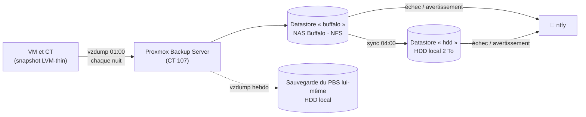

# 06 — Sauvegardes

[← Retour au README](../README.md)

## Vue d'ensemble

## Planning

| Heure | Tâche | Détail |
|---|---|---|
| 01:00 chaque nuit | **Sauvegarde** | Toutes les machines en mode *snapshot*, sauf le PBS lui-même |
| 02:30 | Rétention (buffalo) | 7 quotidiennes · 4 hebdomadaires · 6 mensuelles |
| 04:00 | **Synchronisation** | buffalo → hdd (seconde copie, sans propager les suppressions) |
| 05:30 | Rétention (hdd) | Même politique |
| 12:00 / 13:00 | Nettoyage (garbage collection) | Libère les blocs qui ne sont plus référencés |
| Dimanche 06:00 / 08:00 | **Vérification** | Contrôle d'intégrité des blocs de chaque datastore |
| Dimanche 03:00 | Sauvegarde du PBS | vzdump du CT 107 vers le HDD (4 versions gardées) |

Les fichiers de configuration correspondants sont dans [configs/backup/](../configs/backup/).

## Pourquoi Proxmox Backup Server ?

- **Déduplication** par blocs : environ 2 To de données sauvegardées occupent environ 216 Go.
- **Sauvegardes incrémentales** : une nuit complète prend environ 10 min pour une douzaine de machines.
- **Vérification** intégrée, rétention fine, restauration fichier par fichier.
- Intégration native dans Proxmox VE.

## Le défi technique : PBS dans un conteneur non privilégié, sur un NAS NFS

**Le problème.** Je voulais garder le PBS en **LXC non privilégié**, et placer son datastore sur le NAS Buffalo. Mais le root du conteneur (UID 100000 sur l'hôte) n'a aucun droit sur un export NFS : les permissions et le verrouillage de PBS échouaient.

Pistes écartées :
- passer le conteneur en privilégié (moins sûr) ;
- une VM (plus lourde, et je voulais le **même modèle** que les autres services : montage sur l'hôte, puis point de montage dans le conteneur).

**La solution retenue :**
1. une **image disque ext4 creuse** (sparse) est créée sur l'export NFS du Buffalo ;
2. l'hôte la monte en **loop**, avec une dépendance systemd sur le montage NFS ;
3. le point de montage est transmis au conteneur, avec les bons propriétaires et les bonnes permissions.

PBS voit ainsi un vrai système de fichiers local (ext4, verrous POSIX), tout en stockant ses données sur le NAS.

## Sécurité des sauvegardes

- Proxmox VE s'authentifie auprès de PBS avec un **jeton API** limité au rôle *DatastoreAdmin*, sur un seul datastore.
- Le tableau de bord lit l'état des sauvegardes avec un **autre jeton**, en lecture seule (rôle *Audit*), à travers un relais qui n'expose que quelques routes GET.
- La seconde copie se fait **sans propagation des suppressions** (`remove-vanished false`) : une suppression accidentelle sur le datastore principal ne se répercute pas sur la copie.
- **Alertes** : toute erreur ou tout avertissement (sauvegarde, synchronisation, vérification) part immédiatement sur le téléphone.

## Tests de restauration

- **Restauration complète testée** : un conteneur a été restauré sous un nouvel ID, démarré et vérifié, puis supprimé.
- Avant chaque mise à jour risquée, je fais **une sauvegarde + un snapshot**. Les mises à jour critiques sont d'abord **répétées sur un clone** restauré depuis la sauvegarde (voir [04 — Sécurité](04-securite.md#gestion-des-vulnérabilités--cas-dune-faille-php-critique-oct-2026)).

## État vis-à-vis de la règle 3-2-1

| Critère | État |
|---|---|
| **3** copies des données | ✅ production + datastore buffalo + datastore hdd |
| **2** supports différents | ✅ NAS (RAID) + disque local |
| **1** copie hors site | ❌ **pas encore** : c'est la prochaine étape (voir [09 — Roadmap](09-roadmap.md)) |
| **0** erreur à la vérification | ✅ vérification hebdomadaire automatique |
