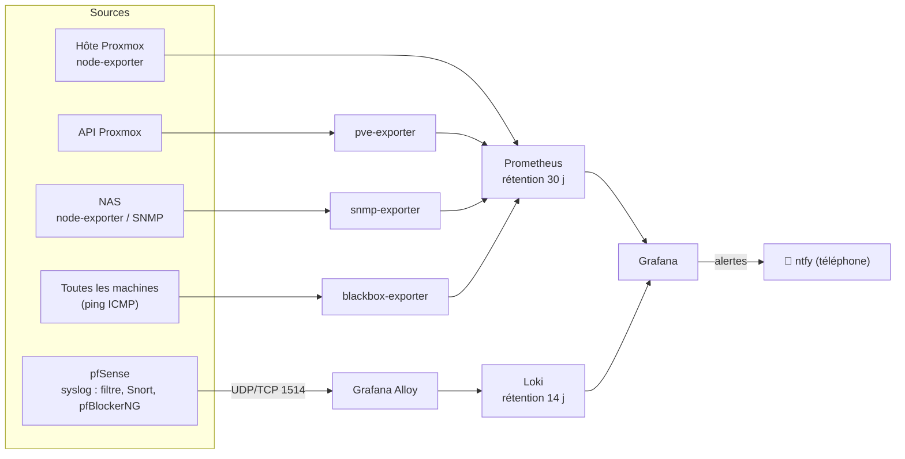
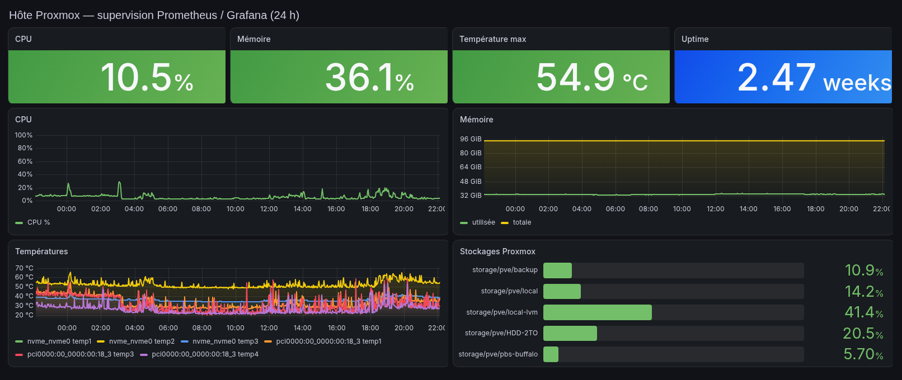

# 07 — Supervision

[← Retour au README](../README.md)

## Architecture

Tout tourne en Docker sur le CT 102 (voir [configs/monitoring/](../configs/monitoring/)).

## Ce qui est surveillé

| Cible | Méthode | Exemples de métriques |
|---|---|---|
| Hôte Proxmox | node-exporter | CPU, RAM, disques, températures, réseau |
| Invités Proxmox | pve-exporter (API, compte en lecture seule) | État, CPU, RAM et disque de chaque VM et CT |
| NAS Buffalo | **SNMP** | État des volumes, espace disque |
| NAS médias | node-exporter | Espace disque, charge |
| Disponibilité | blackbox ICMP | Ping de pfSense, de la box, des NAS et de chaque service |
| pfSense | syslog → Alloy → Loki | Blocages du pare-feu, alertes Snort, requêtes bloquées par pfBlockerNG |

## Tableaux de bord Grafana

- **Vue d'ensemble du lab**, utilisée aussi comme page d'accueil et intégrée dans Homarr.
- **Proxmox** : invités et ressources.
- **Hôte** (Node Exporter Full).
- **pfSense** : journaux du pare-feu.
- **pfBlockerNG** : domaines et IP bloqués, top des clients.
- **Sécurité** : alertes Snort par signature, classe, source et destination.

## Alertes

- Les règles d'alerte sont **provisionnées sous forme de code** (fichiers YAML versionnables).
- Chaque notification est **en français**, et contient :
  - un **résumé** ;
  - une **description** de ce qui se passe ;
  - l'**action recommandée** ;
  - le **lien direct** vers le bon tableau de bord.
- **Envoi sur téléphone** via ntfy, avec un modèle de message personnalisé.
- **Trois canaux séparés** :
  1. **Alertes** de supervision et de sécurité ;
  2. **Échecs de sauvegarde** (notifications natives Proxmox VE et PBS) ;
  3. **Mises à jour disponibles** (Proxmox et images Docker), pour ne pas noyer les alertes importantes.
- Les alertes Snort sont **regroupées** (signature, classe, source, destination, port), et les scans web banals venus d'Internet sont exclus pour éviter la fatigue d'alerte.

## Historique : Beszel et le pont SNMP

Avant cette pile, la supervision reposait sur **Beszel**. Comme il ne savait pas interroger les équipements réseau,
j'ai développé **[baszel-snmp-bridge](https://github.com/Lightshadow02/baszel-snmp-bridge)**, un pont qui traduit les données SNMP pour Beszel.
J'ai ensuite migré vers Prometheus, Grafana et Loki, pour ajouter la **centralisation des journaux** et un **alerting** plus riche.
