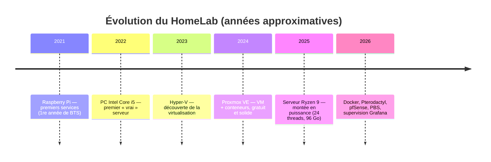

# 08 — Historique et leçons apprises

[← Retour au README](../README.md)

## Évolution du lab

Mon **premier serveur date de ma 1re année de BTS, en 2021**. Depuis, j'ai fait évoluer la plateforme **à peu près chaque année** :

> Les années sont approximatives : environ une étape par an depuis 2021.

### Évolutions récentes (octobre–novembre 2026)

| Changement | Pourquoi |
|---|---|
| Beszel → **Prometheus + Grafana + Loki** | Centraliser les journaux pfSense, alerting en français |
| Partages **SMB → NFS** partout | Problèmes récurrents avec les partages de fichiers |
| Sauvegardes vzdump → **Proxmox Backup Server** | Déduplication, incrémental, vérification, rétention |
| Seconde copie des sauvegardes sur le **disque local** | Ne plus dépendre d'un seul NAS |
| Guacamole → **bureau KDE dans le navigateur** | Expérience complète, moins de briques |
| **pfBlockerNG** : ajout d'un groupe Malware/Phishing | Protection DNS au-delà de la publicité |
| Correctif d'urgence PHP **répété sur un clone** | Ne jamais tester en production |
| **wg-easy v14 → v15** | Suivre les versions maintenues |

## Incidents et leçons apprises

### 1. Les partages de fichiers SMB peu fiables
**Symptôme :** problèmes récurrents avec les partages de fichiers entre les services et les NAS.
**Ce que j'ai fait :** migration de **tous** les montages en NFS, sur un réseau de stockage dédié, avec un script qui fait attendre le démarrage des invités tant que les montages ne sont pas prêts.
**Leçon :** entre serveurs Linux, NFS est plus simple et plus fiable. Il faut aussi gérer l'**ordre de démarrage** : un service qui démarre sur un dossier vide fait plus de dégâts qu'un service qui attend.

### 2. pfSense qui se figeait
**Symptôme :** dès le début, pfSense en VM se figeait régulièrement, sans cause évidente.
**Leçon :** quand le pare-feu est virtualisé, il devient un **point critique** : s'il tombe, tout le lab perd Internet.
J'ai appris à garder un **accès console de secours** (clavier virtuel et capture d'écran par l'hyperviseur), qui fonctionne même quand l'agent invité ne répond plus.

### 3. Le faux positif Snort qui bloquait Google
**Symptôme :** une compilation échouait au téléchargement des dépendances.
**Cause :** Snort, en mode blocage, avait classé un serveur Google comme un scanner.
**Leçon :** un IPS en blocage a besoin d'une **procédure de gestion des faux positifs**. Il faut supprimer la règle précise qui pose problème, pas désactiver la protection.

### 4. PBS sur NAS depuis un conteneur non privilégié
**Symptôme :** le datastore était inutilisable, à cause des permissions NFS face à l'UID décalé du conteneur.
**Solution :** une image ext4 sur le NAS, montée en loop par l'hôte (détails dans [06 — Sauvegardes](06-sauvegardes.md)).
**Leçon :** comprendre le **mapping d'UID** des conteneurs non privilégiés, plutôt que de céder à la facilité du mode privilégié.

### 5. Une faille PHP critique
**Leçon :** une démarche structurée (inventaire, priorisation, répétition sur un clone, sauvegarde, tests avant/après) a évité une régression :
la répétition a révélé que la mise à jour cassait des extensions tierces, **avant** que la production soit touchée.

### 6. Sept jours sans journaux de pare-feu
**Symptôme :** en préparant cette documentation, le tableau de bord Sécurité était vide.
**Cause :** lors d'une intervention par la console de pfSense, une commande d'arrêt de processus trop large avait aussi arrêté le service de journalisation (`syslogd`).
Le pare-feu, Snort et pfBlockerNG ont continué à **bloquer** normalement, mais plus rien n'était **journalisé** ni envoyé à Loki pendant 7 jours.
**Correction :** relance du service, vérification de l'arrivée des journaux, puis ajout d'une vérification systématique après chaque intervention sur pfSense.
**Leçon :** il faut **superviser la supervision**. L'absence de données est un signal en soi, et doit déclencher une alerte au même titre qu'un pic.

### 7. Les déplacements de fichiers sur NFS
En renommant un fichier de 4 To entre **deux montages différents du même export NFS**, la commande `mv` a commencé une copie octet par octet au lieu d'un simple renommage.
**Leçon :** pour le noyau, deux points de montage sont deux systèmes de fichiers. Un renommage doit se faire **à l'intérieur d'un même montage**.
